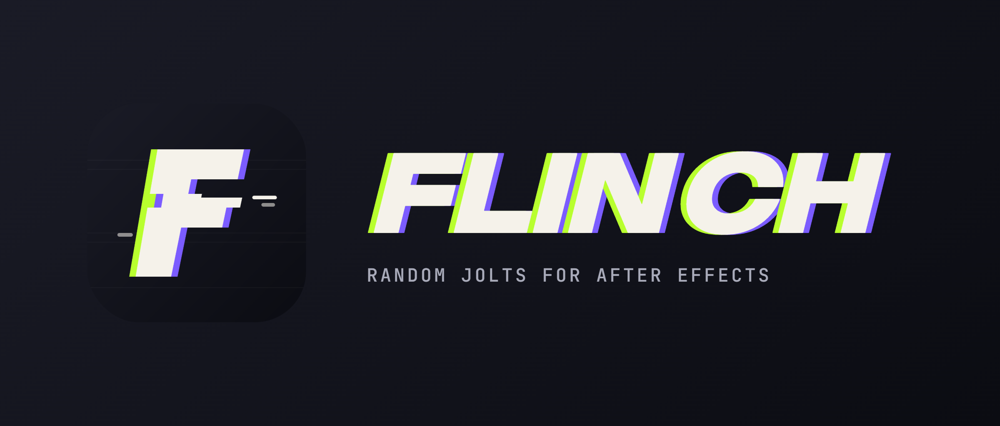

<p align="center">
  
</p>

<p align="center">
  <a href="../../releases/latest"><b>Download the latest release</b></a> ·
  <a href="INSTALL.md">Install guide</a> ·
  <a href="#building">Build from source</a>
</p>

Flinch is an After Effects effect that adds short, random, involuntary-looking
jolts to a layer: blur, color, light, scale, slide and time "twitches" that fire
on their own and fade in and out over a few frames.

> **Educational project.** Flinch was built to learn how this kind of effect
> works and how to write a modern After Effects plugin. It is an independent
> implementation and is **not affiliated with, endorsed by or derived from the
> code of** Video Copilot or its *Twitch* plugin. See [Disclaimer](#disclaimer).

## Features

- Six operators, switched on individually under **Enable**:
  **Blur**, **Color**, **Light**, **Scale**, **Slide** (with RGB split) and **Time**.
  Each has its own controls under **Operator Controls** (tint, colorize, light
  behaviour, scale origin, slide direction and spread, time direction…) and its
  own unique seed.
- Global **Amount** and **Speed**, plus a **Behaviour** group: Ease In/Out,
  Border mode (Mirror, Tile, Transparent, Stretch Edges), Show Twitch Only,
  Seed and Randomize Minimum.
- Deterministic randomness: the same seed always gives the same result, so
  renders are repeatable. **Random Pattern** picks *Modern* (a fast stateless
  hash, the default) or *Twitch Compatible* (for side-by-side comparisons).
- Motion blur for Slide and Scale with constant cost per pixel, regardless of
  how far the content moves.
- GPU rendering through the framework After Effects uses: **CUDA** (NVIDIA)
  or **OpenCL** (AMD/Intel) on Windows, **Metal** on macOS. **Render Using**
  chooses **GPU (CPU fallback)** or **CPU Only**; when the project renders on
  the CPU, or the GPU kernels cannot load, Flinch falls back to the CPU.
- 8, 16 and 32-bit (float) color, SmartFX, multi-frame rendering.
- Windows (x64) and macOS (universal: Apple Silicon + Intel).

## Compatibility

| Platform | Status |
|---|---|
| After Effects 2026, Windows x64 | Tested |
| After Effects 2022–2025, Windows x64 | Expected to work, not tested |
| After Effects 2022+, macOS (Apple Silicon / Intel) | Builds and passes tests in CI; not tested inside After Effects yet |

Current version: **0.2.0**. Details in [INSTALL.md](INSTALL.md#compatibility).

## Project layout

| Path | Contents |
|---|---|
| `core/include/flinch_core.h` | Timing and randomness: when each twitch fires and how strong it is. No After Effects dependency. |
| `core/include/flinch_render.h` | Pixel processing (zoom, slide, blur, light, color) on float images. No After Effects dependency. |
| `plugin/` | The After Effects adapter: parameters, PiPL resource, SmartFX pre-render/render. |
| `plugin/gpu/` | GPU kernels written once (`flinch_kernels.inc`) plus the CUDA, OpenCL and Metal backends. |
| `tests/` | Unit tests for the core and the renderer. |
| `tools/` | `flinch_curves` (dump per-frame state as CSV), `plot_curves.py` (plot it as SVG), `bench_render` (performance), `gpu_check` (run the GPU kernels and compare them with the CPU, Windows). |
| `docs/behaviour.md` | How the effect behaves: timing, randomness and each operator. |
| `scripts/` | Install scripts for Windows and macOS. |
| `docs/brand/` | Logo and banner: `flinch-icon.svg` (source), PNG icons at 256 and 1024 px, and `flinch-banner.png`. |

## Building

Requirements: CMake 3.20+, a C++17 compiler (Visual Studio 2022 on Windows,
Xcode command line tools on macOS) and the
[Adobe After Effects SDK](https://developer.adobe.com/after-effects/), which is
not included in this repository: download it from Adobe and point CMake to its
`Examples` folder (the one with `Headers/`, `Util/` and `Resources/`):

```sh
cmake -S . -B build -DAE_SDK_DIR=/path/to/AfterEffectsSDK/Examples
cmake --build build --config Release
ctest --test-dir build -C Release --output-on-failure
```

Output:

- Windows: `build/Release/Flinch.aex`
- macOS: `build/Flinch.plugin` (universal binary)

**CUDA kernels (Windows).** They are compiled to PTX with `nvcc` from CUDA 12.8.
CMake looks for it in `CUDA_PATH` or `%USERPROFILE%\Tools\cuda-12.8`; the
standalone `cuda_nvcc` and `cuda_cudart` archives from NVIDIA's redistributables
are enough, no full toolkit install. Without `nvcc` the build still succeeds and
CUDA projects render Flinch on the CPU. OpenCL and Metal kernels need no extra
tools: they are compiled by the driver at runtime.

To check the GPU kernels on a Windows machine without After Effects:

```sh
build/Release/gpu_check
```

The `AE_SDK_DIR` environment variable, or a copy of those three folders in
`third_party/ae_sdk/` (ignored by git), work too. Without the SDK, CMake still
builds and tests the core and the tools, and skips the plugin.

Every push is also built and tested on GitHub Actions for both platforms; the
plugins can be downloaded from the run's artifacts.

## Installing

Prebuilt plugins are attached to each [release](../../releases); the
step-by-step guide (including manual install and compatibility) is in
[INSTALL.md](INSTALL.md). From a source build:

**Windows** (asks for administrator rights, since the plug-ins folder is in
Program Files):

```powershell
pwsh -ExecutionPolicy Bypass -File scripts/install.ps1
```

**macOS**:

```sh
sh scripts/install-mac.sh /path/to/Flinch.plugin
```

Then restart After Effects and apply **Effect › Flinch › Flinch**.

## Disclaimer

- **Purpose.** This project is for educational and personal use: studying how
  a "twitch"-style effect behaves and practising After Effects plugin
  development. It is provided as is, without warranty of any kind.
- **No affiliation.** *Twitch* is a product of Video Copilot. *After Effects*
  is a trademark of Adobe. Flinch is not affiliated with or endorsed by either
  company.
- **Independent implementation.** Flinch does not contain code, assets or
  binaries from Video Copilot's Twitch. Its behaviour (timing, ranges,
  formulas) is described in `docs/behaviour.md`, and the implementation was
  written from that description.
- **Adobe SDK.** The After Effects SDK is not part of this repository; each
  developer downloads it from Adobe under Adobe's license terms.
- **Use responsibly.** If you own a licence for the original plugin, respect
  its terms. Do not use this project to circumvent anyone's licensing.
